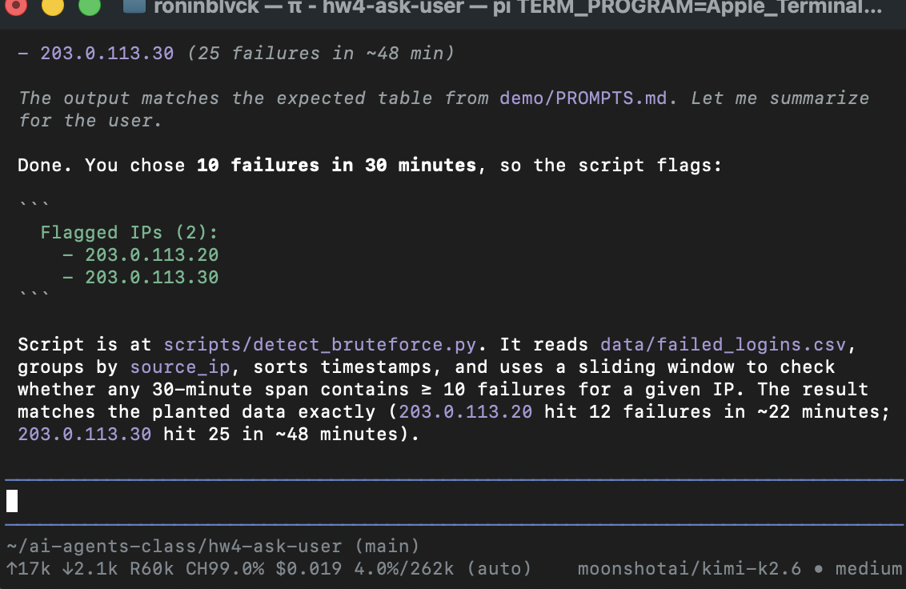
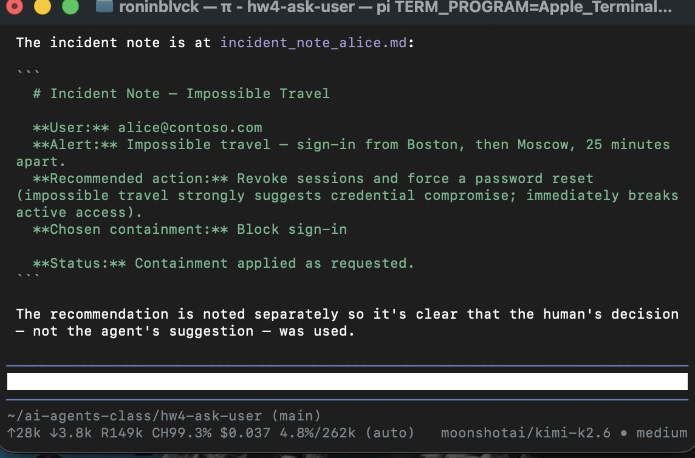
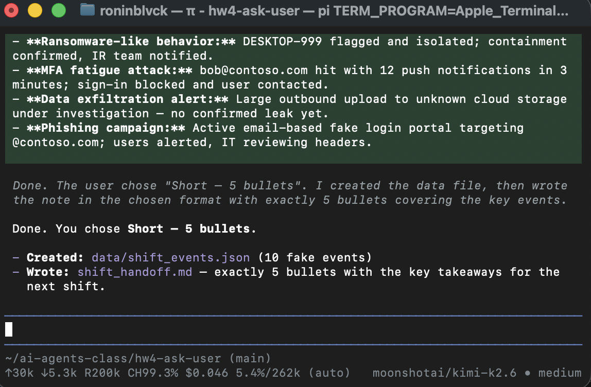
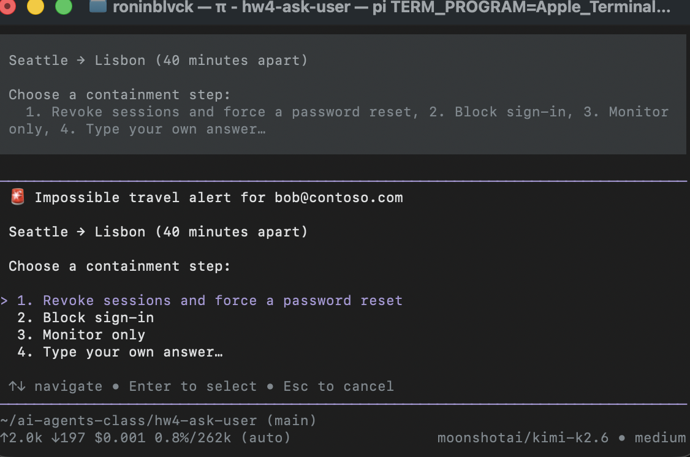
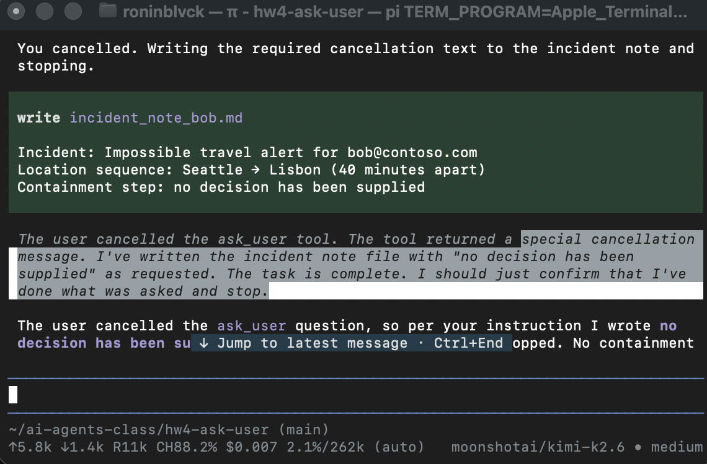

# `ask_user` — Human-in-the-Loop Pi Extension (HW4)

A model-callable Pi extension that pauses the agent, renders an interactive
terminal picker, and waits for a human decision before the agent continues.

## What it does

`ask_user` registers a single tool (`exposure: "model-only"`) that the agent
calls when a decision belongs to a human, plus a `/ask_user` **extension
command** that runs a fixed scenario flow with no prompt. The tool renders a
TUI picker with:

- The question text
- Numbered options (if provided)
- A "Type your own answer…" row (unless `allow_free_text: false`)
- Arrow-key navigation, Enter to select, Esc to cancel
- An inline editor for free-text answers

The tool returns a structured result that is unambiguous about what happened:

```json
{
  "status": "answered" | "cancelled",
  "answer": string,
  "choice_index": number | null,
  "free_text": boolean
}
```

- **Answered option** — `status: "answered"`, `answer: <label>`,
  `choice_index: <1-based>`, `free_text: false`.
- **Free-text answer** — `status: "answered"`, `answer: <typed text>`,
  `choice_index: null`, `free_text: true`.
- **Cancelled** — `status: "cancelled"`,
  `answer: "no decision has been supplied"`, `choice_index: null`,
  `free_text: false`.

The contract is frozen in [`PROGRESS.md`](PROGRESS.md) under W2-0.

## How to run

```bash
cd ~/ai-agents-class/hw4-ask-user
npm install
```

### Tests

```bash
npm test           # 43/43 contract tests (vitest)
npm run typecheck  # TypeScript --noEmit
npm run smoke      # Model-free extension load smoke test
npm audit          # 0 vulnerabilities
```

### Interactive demo

```bash
npm run tui        # same as: pi --extension ./src/index.ts
```

Once loaded, type `/ask_user` to run the two-step scenario flow. If you edit the
extension while Pi is running, `/reload` (or restart) so the command
re-registers.

### Standalone picker (no model, no Pi)

```bash
npm run ask                          # prompts for question + options
npm run ask -- --preset incident     # jump straight to a preset
npm run ask -- -q "Pick" -d "Why" -o "A" "B" "C"
```

The standalone CLI renders the same ANSI picker directly in the terminal and
prints the contract JSON. It requires a real TTY and fails with a clear message
if piped.

## Presets & the `/ask_user` command

`/ask_user` is a **Pi extension command** (registered with
`pi.registerCommand()` in `src/index.ts`). It is *not* a prompt template:
`docs/prompt-templates.md` says templates turn Markdown into reusable prompts
with **no executable behavior**, while `docs/extensions.md` ("Choose an
integration point") gives commands to code that must add terminal UI,
run other tools, or perform work. This flow owns a picker, a second picker, and
a task, so a command is the right API.

Typing `/ask_user` runs the whole flow with no other prompt — and it loops:

1. **Scenario picker** — `ask_user` with `preset: "scenario"`.
2. **Task picker** — `ask_user` with the preset for the scenario you picked
   (`bruteforce` / `incident` / `handoff`). Free text is **off** for the
   `bruteforce` and `handoff` pickers: a typed answer cannot be acted on (a
   typed threshold makes the detector fail with `Task failed`; a typed handoff
   answer silently falls through to the full timeline). The `incident` picker
   **keeps free text** — the note records whatever you type.
3. **Task** — runs with your answer:
   - **brute-force** — runs `scripts/detect_bruteforce.py` on
     `data/failed_logins.csv` with the chosen threshold (passed as
     `BF_THRESHOLD` / `BF_WINDOW`), and writes `bruteforce_result.txt`.
   - **incident** — writes `incident_note.md` recording the chosen step
     (**recorded, NOT executed**).
   - **handoff** — writes `shift_handoff.md` in the chosen format.
4. **Repeat?** — asks `Run another scenario?` with a **short result summary** above
   the options (`Pick another scenario` / `Exit`, free text off). The summary
   depends on what just ran:
   - **bruteforce** — threshold used, flagged IP count and list, plus the
     output filename.
   - **incident** — the chosen containment step, recorded-not-executed notice,
     and the note filename.
   - **handoff** — the 5 bullets (Short) or a "saved to file" message
     (Detailed).
   - **failure** — `Task failed: <message>`.
   `Pick another scenario` returns to step 1; `Exit` ends the command with
   `Done.` Esc/Ctrl+C at this question also exits — here exiting is the safe
   default.

Cancel (Esc/Ctrl+C) at the **scenario** or **task** pickers still stops,
**writes nothing**, and reports exactly `no decision has been supplied`.

The same presets are also reachable from the tool and the standalone CLI.

| Preset key | Scenario | Question | Options |
|-----------|----------|----------|---------|
| `scenario` | Selector | Which scenario do you want to run? | Brute-force / Impossible travel / Shift handoff |
| `bruteforce` | Brute-force detector | Which brute-force alert threshold? | 5/10 min · 10/30 min · 20/1 hr |
| `incident` | Impossible travel | Which containment step should I take? | Revoke sessions · Block sign-in · Monitor only |
| `handoff` | Shift handoff | How should the next shift receive the note? | Short — 5 bullets · Detailed — full timeline |

Each preset supplies a **description** (scenario context) and per-option
**descriptions** (the trade-off for each choice), both rendered in the picker.

```
──────────────────────────────────
 Which containment step should I take?

 Impossible travel: alice@contoso.com signed in from Boston,
 then Moscow 25 minutes later. Strongly suggests credential
 compromise. The choice is recorded, not executed.

> 1. Revoke sessions and force a password reset
      Recommended — immediately breaks active access
  2. Block sign-in
      Prevents new sessions; does not kill existing ones
  3. Monitor only
      Watch for further activity; take no action now
  4. Type your own answer…

  ↑↓ navigate • Enter to select • Esc/Ctrl+C to cancel
──────────────────────────────────
```

## The contract

**Inputs**

| Parameter | Type | Required | Default |
|-----------|------|----------|---------|
| `question` | string | yes | — |
| `options` | `{ label, description? }[]` | no (omit for free-text-only) | — |
| `allow_free_text` | boolean | no | `true` |
| `description` | string | no | — |
| `preset` | `scenario` \| `bruteforce` \| `incident` \| `handoff` | no | — |

- Empty/whitespace `question` → **error**.
- Duplicate or empty option labels → **error**.
- Explicitly empty `options: []` → **error**.
- No options + `allow_free_text: false` → **error** (nothing to ask).
- Unknown `preset` → **error**.

**Picker behavior**

| Key | In option list | In free-text editor |
|-----|---------------|---------------------|
| ↑ / ↓ | Move highlight | — |
| Enter | Select option / open editor | Submit text (empty → back to list) |
| Esc | Cancel question | Return to option list |
| Ctrl+C | Cancel question | Cancel question |

## The 4 demos

All data is synthetic (`@contoso.com`, RFC 5737 documentation IPs).

### Demo 1 — Brute-force detector (alert threshold)

**Prompt:** Write a brute-force detector for `data/failed_logins.csv`. Before
writing code, ask the threshold: 5/10 min, 10/30 min, or 20/1 hr.

**Pick:** `10 failures in 30 minutes`

**Correctness check:** The detector flags exactly `203.0.113.20` and
`203.0.113.30`.



### Demo 2 — Impossible travel (containment decision)

**Prompt:** Alert for `alice@contoso.com` (Boston → Moscow, 25 min apart).
Before writing the incident note, ask which containment step to take.

**Pick:** `Block sign-in`

**Correctness check:** The incident note records the chosen containment step;
the agent does not invent a default.



*Re-run after fix: see below (placeholder for `demo2-result-after-fix.png`). Joe re-runs Demo 2 tomorrow.*

### Demo 3 — Shift handoff (format)

**Prompt:** Draft a shift handoff from 10 fake events. Before writing it, ask
whether the next shift wants it short (5 bullets) or detailed (full timeline).

**Pick:** `Short — 5 bullets`

**Correctness check:** The handoff note is short (~5 bullets), not a full
timeline.



### Demo 4 — Cancel run (honest stop)

**Prompt:** Same as Demo 2, but with `bob@contoso.com` (Seattle → Lisbon,
40 min apart). If cancelled, write `"no decision has been supplied"` and stop.

**Pick:** **Esc** (cancel)

**Correctness check:** The note records exactly `no decision has been supplied`;
the agent stops with no invented containment step.

  


## Review fixes (W2-4 → W2-6)

Two problems found during Joe's review of the W2-4 demo run.

### 1. Overclaim — "Containment applied as requested."

**Problem:** The answered incident notes said `"Status: Containment applied as
requested."` The agent cannot apply anything; it only records the human's
decision.

**Fix:** The `answeredResult` text now explicitly says:

> `"This is a recorded decision that has NOT been executed; the agent must not
> claim it was carried out."`

**What it taught:** Tool-result text shapes model behavior. If the tool tells
the model a decision was "applied," the model parrots that in downstream
artifacts. Honesty in the tool contract must include honesty in the natural-
language content returned to the model.

**Commits:** red `2ae3726` (3 failing tests), green `a47d73c` (20/20 pass).

### 2. Markdown printed literally in the picker

**Problem:** Options sent by the model with markdown bold/italic (`**Block**
sign-in`, `__Monitor__ only`) were rendered with the asterisks/underscores
visible in the terminal picker.

**Fix:**

1. The tool description now states: `"Question and option text are plain text
   (not markdown)."`
2. A `stripMarkdown()` helper removes `**` and `__` before rendering the
   question, labels, and descriptions in the picker.

**What it taught:** Models often wrap option text in markdown for emphasis,
but the TUI is plain ANSI text. The extension must sanitize input that is
designed for a different rendering medium, and the contract should guide the
model toward clean input.

**Commits:** red `2ae3726` (3 failing tests), green `a47d73c` (20/20 pass).

### 3. `renderCall` transcript line ignored presets

**Problem:** When the model called `ask_user` with a preset, the gray transcript
line (drawn by `renderCall`) showed only `1. Type your own answer…` instead of
the preset's options. `execute()` applied the preset, but `renderCall` used the
raw `args.options`, which is empty for a preset call.

**Fix:** `renderCall` now calls `applyPreset(args)` before listing options, the
same as `execute()`.

**What it taught:** A tool has two inputs to the same data — `execute()` for
behavior and `renderCall`/`renderResult` for display. Any transformation of
arguments (like preset expansion) must be applied in both, or the transcript
lies about what the tool was asked.

**Commits:** red `2e9546c` (2 failing tests), green `590b51c` (30/30 pass).

### 4. Result summary never shown after a scenario finishes

**Problem:** After the task ran, the command only showed a one-line notification
(e.g. "Brute-force detector ran with threshold: …") and immediately jumped to
`Run another scenario?`. The operator (and any recording) never saw what
actually happened — flagged IPs, chosen containment, or handoff bullets.

**Fix:** The repeat picker now receives a `description` built from the task
result:
- **bruteforce** — parses flagged IPs from the detector output and shows
  `Threshold: <answer>. Flagged IPs (N): <ips>. Full output: bruteforce_result.txt`.
- **incident** — shows the chosen step plus `Recorded, NOT executed. Saved to
  incident_note.md`.
- **handoff (Short)** — shows the 5 bullets inline.
- **handoff (Detailed)** — shows `Full 10-event timeline saved to shift_handoff.md`.
- **failure** — shows `Task failed: <message>`.

**What it taught:** A picker that asks "do another?" without showing what just
happened leaves the user blind. The description field is the right place for a
short result summary because it sits above the options in the same UI frame.
Parsing a small chunk of structured output (the flagged-IP list) keeps the
screen readable while the full details stay in the file.

**Commits:** red `4d322fb` (5 failing tests), green `59f9a4a` (43/43 pass).

## Failures we saw

| # | What | When | Outcome |
|---|------|------|---------|
| 1 | **Demo 4 first run** recorded `"Block sign-in"` instead of cancelling — either an option was accidentally picked or the model ignored the cancel result. | 10/9 | 10/11 re-run passed twice. |
| 2 | **Demo 1** second run reused the existing script rather than rebuilding — the detector was already there from the first run. | 10/9 | Picker and result still correct; re-run with fresh state captured. |
| 3 | **W2-1 harness** sent `Key.*` id strings instead of raw terminal bytes (`\r`, `\x1b[B`, `\x1b`) — `matchesKey` expects real input. | W2-1 | 6 tests timed out; fixed in W2-2, all pass. |
| 4 | **Dependencies** first pointed at local `file:` paths. | W2-2 | Switched to published `@earendil-works/pi-coding-agent` / `pi-tui` `1.1.0`; `npm audit` → 0. |
| 5 | **Contract** contradicted itself on `options: []` vs omitting `options`. | W2-2 | Frozen in W2-0: `options: []` is an error; omitting `options` is the free-text-only path. |

## How cancel stays honest

Cancel is the most important edge case because it is where an agent is most
likely to hallucinate a default action.

1. **The hard-coded phrase.** `cancelledResult()` hard-codes
   `answer: "no decision has been supplied"`. There is no parameter, no
   configuration, and no path to a different cancel message.

2. **The tool-result text.** On cancel, the content says:
   `"The user cancelled the question: no decision has been supplied. Do not
   assume a choice was made."`

3. **The tests.** Cancel tests verify `structuredContent.answer`,
   `details.answer`, and `content[0].text` all contain the exact phrase.

4. **The prompt instruction.** The demo prompts explicitly tell the agent what
   to do on cancel — write `"no decision has been supplied"` in the incident note
   and stop. No default, no assumption.

If the agent ever writes a containment step after a cancel, the bug is in the
model's interpretation of an unambiguous tool result — not in the tool.
